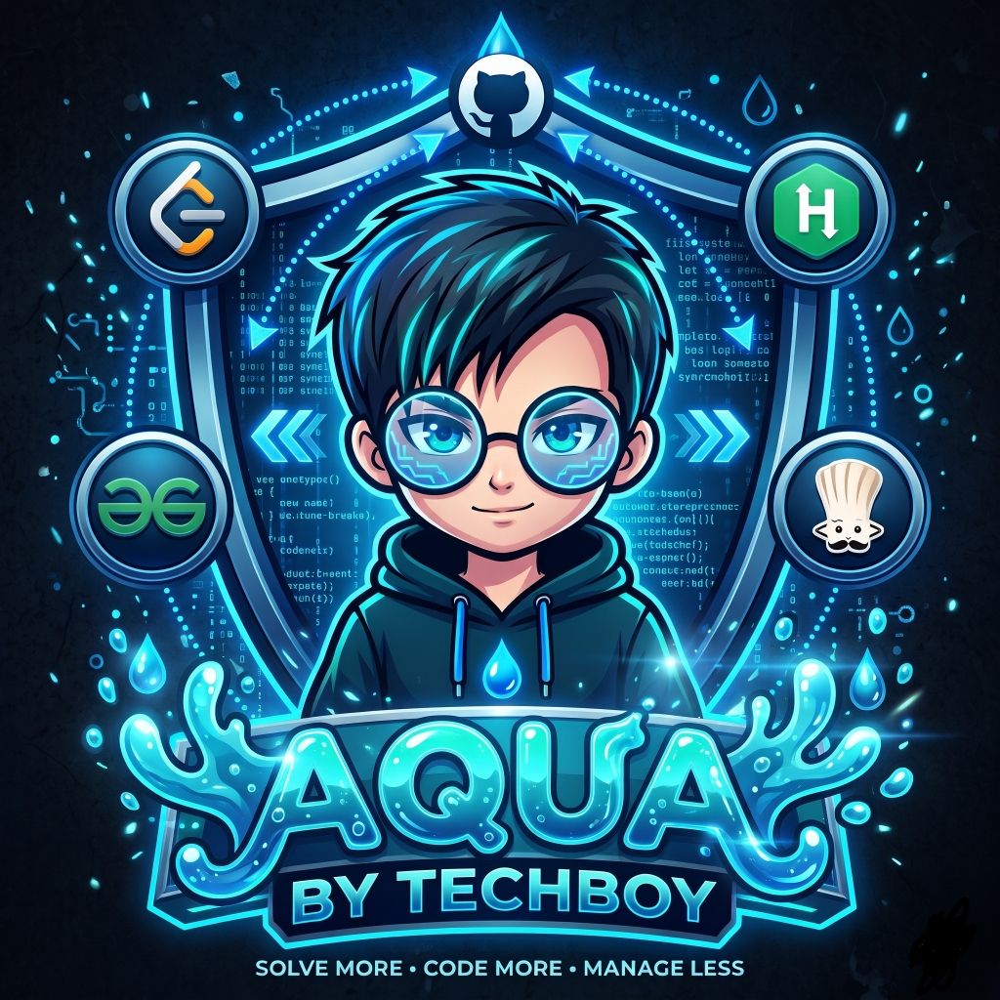

<div align="center">



# Aqua by TechBoy

### ⚡ Solve More. Code More. Manage Less ⚡

Aqua is a privacy-first, all-in-one browser extension that automatically syncs your accepted coding solutions from LeetCode, GeeksforGeeks, CodeChef, and HackerRank directly to GitHub. Your solutions deserve to be saved, not manually organized. Stay focused on solving problems while Aqua handles the busywork - keeping your solutions neatly organized, securely stored, and ready whenever you need them.

⚡ Less manual work & Time managing code. More time building, coding & solving ⚡

**Live Link:** *Coming soon (Chrome Web Store)*

<p>
  
  
  
  
</p>

</div>

---

## How It Works

1. **Connect GitHub** — Sign in with a Personal Access Token (`repo` scope) or GitHub OAuth Device Flow.
2. **Solve a Problem** — Code as usual on LeetCode, GeeksforGeeks, CodeChef, or HackerRank.
3. **Auto-Synced** — Aqua detects accepted submissions (or click the floating **Push** pill) and organizes your code into GitHub:

```text
your-repo/
├── README.md                  # Auto-updated live stats & problem catalog
├── LeetCode/
│   └── 0009-palindrome-number/
│       ├── 0009-palindrome-number.py
│       └── README.md          # Problem statement & metadata
├── GeeksforGeeks/
├── CodeChef/
└── HackerRank/
```

---

## Supported Platforms

| Platform | Auto-Sync | Floating Push Pill | Problem `README.md` |
| :--- | :---: | :---: | :---: |
| **LeetCode** | ✅ | ✅ | ✅ |
| **GeeksforGeeks** | ✅ | ✅ | ✅ |
| **CodeChef** | ✅ | ✅ | ✅ |
| **HackerRank** | ✅ | ✅ | ✅ |

---

## Features

- **All-in-One Multi-Platform Sync**: Automatically detects accepted submissions on **LeetCode**, **GeeksforGeeks**, **CodeChef**, and **HackerRank**—toggle any or all platforms in Settings.
- **Instant GitHub Connection**: Connect in seconds with a **Personal Access Token** (`repo` scope) or **GitHub OAuth Device Flow** (no backend server, no embedded secret).
- **Create or Select Repository**: Create a new Private/Public repository (with an auto-generated root `README.md`) or pick an existing repository and branch.
- **Automatic File Organization**: Saves solutions cleanly under `Coding-Solutions/<Platform>/<Problem>/solution.<ext>` with an auto-generated `README.md` per problem.
- **Progress Tracking Popup**: View total **Problems Solved**, **Easy / Medium / Hard** counts, and per-platform breakdowns (`LC · GfG · CC · HR`) with one-click retry for pending syncs.
- **Cross-Browser MV3**: Native builds for Chrome, Edge, Brave, Opera, Vivaldi, Firefox, and Safari source packaging.

---

## Extension Screenshots

> *Screenshots coming soon — Chrome Web Store & live extension previews will be added here.*

---

## Why Aqua?

Most extensions only support a single coding site or clutter your browser with unnecessary popups and tracking. **Aqua** brings **LeetCode, GeeksforGeeks, CodeChef, and HackerRank** into one lightweight, clean extension so you can focus on solving problems while your GitHub portfolio updates automatically.

---

## Privacy & Security

> **Built by an Indian student developer.**  
> **Aqua is a 100% secure extension — a student never wants your data.**

- **Privacy Zone Protection**: On all non-coding websites (banking, social media, email, etc.), Aqua automatically enters **Privacy Zone**, greys out its interface with a lock icon, and stays completely inactive—it only activates on **LeetCode, GeeksforGeeks, CodeChef, and HackerRank** (Settings remain accessible anytime).
- **Minimal Permissions**: Aqua only requests `storage`, `notifications`, `activeTab`, and host access strictly limited to the 4 supported coding platforms and GitHub—never `<all_urls>`.
- **Zero Backend / Zero Tracking**: Aqua has no servers, no analytics, and no third-party trackers.
- **Local-Only Storage**: Your GitHub token, settings, and sync history stay strictly inside your browser's local storage (`chrome.storage`).
- **Direct to GitHub**: Your code goes directly from your browser to GitHub's official REST API—nowhere else.

See [PRIVACY.md](PRIVACY.md) and [SECURITY.md](SECURITY.md) for full details.

---

## Future Roadmap

- Official **Chrome Web Store** launch with custom PNG branding
- Additional coding platforms (Codeforces, AtCoder, InterviewBit)
- Richer conflict-resolution UI for duplicate submissions
- Multi-repository routing per platform

---

## Contributing

**Everyone is welcome to improve this project — let's grow together!**  
Whether it's fixing a selector, adding a new platform adapter, or improving the UI, feel free to open an issue or submit a Pull Request on [GitHub](https://github.com/chimataraghuram/Aqua/pulls). See [CONTRIBUTING.md](CONTRIBUTING.md) to get started.

---

## License

Contributions to this repository are warmly welcomed. However, **copying, rebranding, or redistributing this extension as your own project is strictly not allowed.**

---

## Developer

<div align="center">


### CHIMATA RAGHURAM (TECHBOY)

*Indian Student Developer · Full-Stack Developer & AI Enthusiast*  
*Secure extension — a student never wants your data.*

<table>
  <tr>
    <td align="center" width="50%">
      <a href="https://www.linkedin.com/in/chimataraghuram/">
        
      </a>
      <br /><br />
      <strong>💼 Professional Network</strong><br />
      <sub>Let's connect, share insights &amp; discuss career opportunities</sub>
    </td>
    <td align="center" width="50%">
      <a href="https://github.com/chimataraghuram">
        
      </a>
      <br /><br />
      <strong>🐙 Open Source</strong><br />
      <sub>Browse repositories, star projects &amp; check latest commits</sub>
    </td>
  </tr>
  <tr>
    <td align="center" width="50%">
      <a href="mailto:chimataraghuram02a@gmail.com">
        
      </a>
      <br /><br />
      <strong>📧 Direct Inquiries</strong><br />
      <sub>Fast response for project collaborations, freelancing &amp; roles</sub>
    </td>
    <td align="center" width="50%">
      <a href="https://github.com/sponsors/chimataraghuram">
        
      </a>
      <br /><br />
      <strong>💖 Support &amp; Fuel</strong><br />
      <sub>Fuel open-source AI builds, research &amp; developer tools</sub>
    </td>
  </tr>
</table>

<br />

*💡 Click any button above to reach out — I'm always open to discussing new AI projects, agent workflows, and collaborations!*

**Let's build something amazing together! 🚀**

</div>

---

## Support & Contributing

If **Aqua** saves you time, please consider giving this repository a **⭐ Star** on GitHub!

- Found a bug or have a feature request? [Open an Issue](https://github.com/chimataraghuram/Aqua/issues)
- Want to contribute? Fork the repo and submit a [Pull Request](https://github.com/chimataraghuram/Aqua/pulls)

---

<div align="center">

**COOKED BY RAGHU ❤️**

</div>
